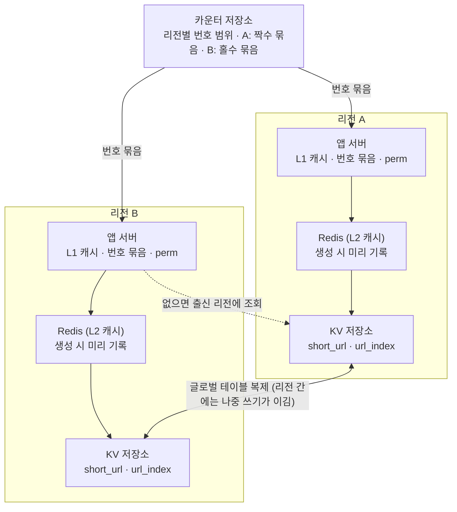

# URL 단축 서비스 시스템 설계 면접 정리 (v1~v3)

> 2026-11-20 작성. claude.ai 문서 [URL 단축 서비스 시스템 설계 면접 정리](https://claude.ai/artifact/V8u8ThZu3s7vnVxomHpuGc)를 저장소에 옮긴 사본이다. Part 1 은 `url-shortener` 모듈에 실제로 구현한 v1~v3 이고, Part 2 는 구현 없이 논의만 한 10억 사용자 규모의 설계다.

# Part 1. 사용자 100명 규모 (v1~v3 구현)

## 1. 요구사항과 규모 추정

사용자 100명 규모라면 DB 한 대로 충분하다. 그래서 설계의 핵심은 처리량이 아니라 **키를 어떻게 만들고 충돌을 어떻게 다루느냐**다.

**기능 요구사항**: 긴 URL 을 받아 짧은 키를 돌려주고(POST), 키로 접속하면 원본으로 리다이렉트한다(GET). 로그인·만료·통계·커스텀 별칭은 범위 밖이다.

**규모 추정** (가정값이다. 면접에서는 가정을 먼저 말하고 계산한다)

| 항목 | 가정 | 계산 | 결과 |
| --- | --- | --- | --- |
| 쓰기 | 1인당 하루 10건 | 100명 × 10 | 하루 1,000건 ≈ 초당 0.01건 |
| 읽기 | 읽기:쓰기 = 10:1 | 1,000 × 10 | 하루 1만 건 ≈ 초당 0.1건 |
| 저장 | 행당 약 200 B (URL 평균 100자 + 키·id·시각) | 1,000 × 200 B × 365 | 연 약 73 MB |
| 키 공간 | Base62 7자리 | 62^7 | 약 3.5조 개 |

- 100배로 늘려도 초당 쓰기 1건, 읽기 10건 수준이다.
- 측정을 중단하기 전에 얻은 일부 결과로는, 같은 Mac 에서 세 전략 모두 **초당 2,000건까지 포화되지 않았다**. 부하 생성기가 같은 장비에서 돌았으므로 이 값은 하한으로만 읽는다.
- 그래서 이 규모에서 면접관이 보는 것은 "얼마나 빠른가"가 아니다. **충돌·중복·동시성·트랜잭션 경계를 정확히 다루는가**다.

## 2. API 와 데이터 모델

API 는 두 개다. 리다이렉트는 **302** 로 하고, 키 컬럼에는 **대소문자를 구분하는 collation** 이 반드시 필요하다.

| API | 요청 | 응답 |
| --- | --- | --- |
| `POST /api/urls` | `{"url": "https://..."}` | 201 `{shortKey, shortUrl}` / 400 검증 실패 / 503 키 발급 실패 |
| `GET /{shortKey}` | — | 302 + `Location` / 404 |

**302 vs 301**: 301 은 브라우저가 영구 캐시해서 서버 부하는 줄지만, 이후에 클릭 통계·만료·목적지 변경을 붙일 수 없다. 나중에 기능을 붙일 여지를 남기려고 302 를 골랐다.

```sql
CREATE TABLE short_url (
    id           BIGINT        NOT NULL AUTO_INCREMENT PRIMARY KEY,
    short_key    VARCHAR(16)   CHARACTER SET ascii COLLATE ascii_bin NULL,
    original_url VARCHAR(2048) NOT NULL,
    created_at   DATETIME(6)   NOT NULL,
    CONSTRAINT uk_short_url_short_key UNIQUE (short_key)
);
```

- **`short_key` 의 UNIQUE** 가 모든 전략의 최후 방어선이다. 애플리케이션에서 하는 중복 확인은 최적화일 뿐이다.
- **`ascii_bin`**: MySQL 8 의 기본 collation(`utf8mb4_0900_ai_ci`)은 대소문자를 무시한다. 그래서 Base62 의 `a` 와 `A` 를 같은 키로 본다(7절 함정 1).
- **입력 검증**: http/https 만 받고, host 가 있어야 하고, 2048자 이하이며, 짝 없는 UTF-16 은 거절한다. `javascript:` 링크를 막아 오픈 리다이렉트나 XSS 의 통로가 되지 않게 한다.
- **조회 키 검증**: `^[0-9a-zA-Z]{1,16}$` 에 맞지 않으면 DB 에 가지 않고 바로 404 를 준다.

## 3. 키 생성 전략 한눈에 비교

세 전략 모두 요청당 SQL 은 2회로 같다. 차이는 **충돌이 언제 생기는가, 같은 URL 을 어떻게 처리하는가, 키를 추측할 수 있는가**에서 난다. 구현은 `shortener.key-strategy` 설정 하나로 전환한다.

| 전략 | 키 만드는 법 | 요청당 SQL | 충돌 | 같은 URL 재요청 | 키 추측 | DB 여러 대(샤딩) |
| --- | --- | --- | --- | --- | --- | --- |
| counter (v1) | AUTO_INCREMENT id → Base62 | INSERT + UPDATE | 없음 (id 가 유일) | 매번 새 키 | 쉬움 (순차) | 불가 (샤드별 id 가 겹침) |
| random (v2) | Base62 무작위 7자 | exists + INSERT | 점유율 p 로 증가, 재시도 | 매번 새 키 | 어려움 | 가능 (키로 라우팅) |
| md5 (v3) | Base62(MD5(url) mod 62^7) | select + INSERT | 해시 앞자리 충돌 → salt 체인 | **같은 키 (중복 제거)**, SQL 1회 | URL 을 알면 계산 가능 | 가능 (키로 라우팅) |
| 분산 카운터 (v4, 보류) | 전역 고유 id (범위 할당·Snowflake 등) → Base62 | INSERT 1회 | 없음 | 매번 새 키 | 설계에 따라 | 이 전략이 필요한 이유 자체 |

- **한 줄 결론**: 단순함은 counter, 추측 불가는 random, 중복 제거는 md5, 샤딩은 분산 카운터다.
- 흔히 "counter 만 SQL 을 2번 쓴다"고 오해한다. random 과 md5 도 확인 쿼리가 있어서 왕복 수는 같다.
- 샤딩 칸의 "키로 라우팅"은 샤드 = f(키) 규칙이다. 같은 키는 항상 같은 샤드로 가므로, 샤드별 UNIQUE 만으로 전역 유일성이 지켜진다(8절).

## 4. v1 counter: AUTO_INCREMENT → Base62

DB 가 발급한 id 를 Base62 로 바꾸므로 **충돌이 구조적으로 없다.** 대신 키를 얻으려면 먼저 INSERT 해야 한다.

1. `short_key` 없이 INSERT 해서 IDENTITY 로 id 를 받는다 (JPA `save()` 시점에 INSERT 가 바로 나간다)
2. `Base62.encode(id)` 로 키를 만든다 (id 1 → `"1"`, 62 → `"10"`)
3. 엔티티에 키를 설정한다. 커밋 시 변경 감지로 UPDATE 가 나간다

- **장점**: 단순하고, 충돌·재시도가 없고, 키가 가장 짧게 시작한다(사용자 100명 규모면 2~3자리).
- **단점**: 키가 순차라서 다음 키를 추측해 다른 사람의 URL 을 열람할 수 있다. id 발급이 DB 한 대에 묶여 있어서 샤딩하면 샤드마다 id 가 겹친다.
- **UNIQUE 제약과 NULL**: INSERT 직후 `short_key` 가 잠깐 NULL 인 행이 여러 개 생겨도 괜찮다. MySQL UNIQUE 인덱스는 NULL 을 여러 개 허용한다.
- **Base62 decode 주의**: 외부 입력을 decode 할 때는 `Math.multiplyExact` 로 오버플로가 예외가 되게 한다. 조용히 음수로 뒤집히면 엉뚱한 id 로 리다이렉트된다.

**면접에서 말할 것**: "가장 단순하고 안전한 출발점이다. 다만 키를 추측할 수 있고 DB 한 대에 의존한다. 이 두 가지가 다음 단계(random, 분산 카운터)로 가는 이유다."

## 5. v2 random: 무작위 키 + 중복 확인 + 재시도

중복 확인은 최적화일 뿐이고, 정합성은 **UNIQUE 제약과 위반 시 재시도**가 보장한다. 핵심 학습 포인트는 경쟁 조건과 트랜잭션 경계다.

1. `SecureRandom` 으로 Base62 7자를 만든다 (`nextInt(62)` 를 써서 모듈로 편향이 없게).
2. `existsByShortKey` 가 true 면 1로 돌아간다 (사전 확인 충돌).
3. INSERT 한다. UNIQUE 위반(`DataIntegrityViolationException`)이 나면 1로 돌아간다 (경쟁 조건 충돌: 확인과 INSERT 사이에 다른 요청이 같은 키를 먼저 넣음).
4. 최대 5회 시도한다. 모두 실패하면 **503** 이다 (일시적 실패라서 다시 요청하면 성공할 수 있음).

**트랜잭션 경계**: 재시도 루프 전체를 `@Transactional` 하나로 묶으면, 첫 UNIQUE 위반에서 트랜잭션이 rollback-only 가 된다. 그러면 재시도가 성공해도 커밋 시점에 `UnexpectedRollbackException` 이 난다. 그래서 **시도 한 번 = 트랜잭션 하나**로 한다.

- 루프에는 트랜잭션이 없다. INSERT 는 별도 빈 `ShortUrlInserter` 의 `@Transactional(propagation = REQUIRES_NEW)` 에서 실행한다. 호출자에 트랜잭션이 있어도 실패한 시도만 롤백된다.
- **별도 빈인 이유**: `@Transactional` 은 프록시로 동작한다. 같은 클래스 안에서 `this.insert()` 로 부르면(자기 호출) 애너테이션이 조용히 무시된다. 그래서 둘을 합치면 바깥 트랜잭션 회귀 테스트가 실패하도록 막아 두었다.
- 대가: 바깥 트랜잭션이 있으면 요청 하나가 커넥션을 2개 쓴다. 풀이 거의 차면 요청끼리 두 번째 커넥션을 기다리다 멈출 수 있다.

**키 공간 점유율 p 에 따른 이론값** (시도가 서로 독립이고 최대 5회일 때)

```latex
E[\text{시도 횟수}] = \frac{1 - p^5}{1 - p}, \qquad P(503) = p^5
```

- p = 90% 면 평균 4.1번 시도하고 59% 가 503 이다. 실제로 키 3자리·점유율 90% 시험 실행에서 503 이 약 60% 나왔다.
- 면접 답변: "충돌이 늘면 재시도로는 못 버틴다. 키 길이에 여유를 두거나, 점유율을 감시하다가 일정 수준에서 키 길이를 늘린다." 7자리면 1% 를 채우는 데에도 350억 건이 필요하다.

## 6. v3 md5: 같은 URL → 같은 키

해시의 결정성만으로 **중복 제거와 충돌 처리를 스키마 변경 없이** 푼다. UNIQUE 위반의 뜻이 v2 와 달라서 회복 방법도 다르다.

**키 도출**: `keyOf(url, n)` = Base62(MD5(n == 0 ? url : url + "#" + n) mod 62^7) 이고, 왼쪽을 `0` 으로 채워 7자리로 맞춘다. 16진수 앞 7자리(16^7 ≈ 2.7억)보다 키 공간이 약 1.3만 배 크다.

1. n = 0 부터 `findByShortKey(keyOf(url, n))` 로 조회한다
2. 행이 있고 **원본 URL 이 같으면** 그 키를 반환한다 (중복 제거, SQL 1회)
3. 행이 있고 원본 URL 이 다르면 해시 충돌이다. n + 1 로 넘어간다 (salt 체인)
4. 행이 없으면 INSERT 한다 (REQUIRES_NEW). UNIQUE 위반이 나면 **같은 키를 한 번 다시 조회**한다. 같은 URL 이면 반환하고, 다르면 n + 1 로 넘어간다
5. 5회를 모두 쓰면 503

| | v2 random | v3 md5 |
| --- | --- | --- |
| UNIQUE 위반의 뜻 | 다른 요청이 우연히 같은 키를 가져감 | 같은 새 URL 이 동시에 들어왔을 가능성이 큼 |
| 회복 | 새 무작위 키로 재시도 | 같은 키를 최신 상태로 재조회 |
| 같은 URL 로 동시 요청 16건 | — | UNIQUE 위반 13~15건, 모두 같은 키 · 행 1개로 수렴 |

- **원본 URL 비교는 Java `equals`** 로 한다. `original_url` 컬럼은 대소문자를 무시하는 기본 collation 이라, SQL 로 비교하면 `/CaseA` 와 `/casea` 를 같다고 판단한다.
- **스냅샷 함정**:
  - 호출자에 REPEATABLE READ 트랜잭션이 있으면 첫 조회 때 스냅샷이 고정된다.
  - UNIQUE 검사는 최신 데이터를 보지만 일반 SELECT 는 그 스냅샷을 본다. 그래서 재조회가 "없음"을 돌려주고, 같은 URL 이 k1 에 한 번 더 저장된다.
  - 해결: 재조회를 별도 빈 `ShortUrlFreshReader` 의 `@Transactional(propagation = REQUIRES_NEW, readOnly = true)` 로 실행한다.
- **운영 제약**: `key-length` 를 바꾸면 모든 URL 의 체인이 바뀌어 중복 제거가 깨진다. `max-attempts` 를 줄이면 체인 뒤쪽에 저장된 URL 이 503 을 받는다. 그래서 둘 다 배포 후에는 바꾸지 않는다.
- MD5 는 암호학적으로 깨졌지만, 여기서는 고르게 퍼진 값을 얻는 용도라 문제없다. 7자리로 자르면 어떤 해시든 충돌을 일부러 만들 수 있으므로, 방어선은 해시 강도가 아니라 충돌 처리 로직이다.

## 7. 구현 중 만난 함정

면접에서 가장 설득력 있는 재료다. "설계는 이랬는데 구현하다 이 함정을 만났고, 이렇게 찾아 이렇게 풀었다"는 형식으로 말한다.

| 함정 | 증상 | 찾은 계기 | 해결 |
| --- | --- | --- | --- |
| 1. 키 컬럼이 대소문자 무시 collation | counter 의 id 10(`a`)과 36(`A`)이 충돌한다. 끝자리가 A~Z 인 id 약 42% 가 500. GET 이 다른 행으로 리다이렉트될 수도 있음 | random 동시성 테스트의 설명되지 않는 503(확률 3×10^-6 인데 발생). 테스트를 느슨하게 고치지 않고 원인을 추적 | `CHARACTER SET ascii COLLATE ascii_bin` |
| 2. 위 수정의 부작용 | 비 ASCII 키(`/한글`)로 GET 하면 "Illegal mix of collations" 500. 로그를 폭주시키는 수단이 됨 | 최종 리뷰에서 실제 HTTP 로 재현 | 조회 전에 `^[0-9a-zA-Z]{1,16}$` 를 검사하고, 어긋나면 DB 없이 404 |
| 3. 재시도 루프의 트랜잭션 | 바깥 트랜잭션이 생기면 첫 위반에 rollback-only 가 되어, 재시도가 성공해도 500 (실제로는 세션에 남은 실패 엔티티 때문에 Hibernate `AssertionFailure` 가 먼저 남) | "애너테이션을 안 붙였다"는 전제가 주석으로만 지켜짐 | `REQUIRES_NEW` 를 별도 빈에 명시 + 바깥 트랜잭션 회귀 테스트 |
| 4. 자기 호출 | 같은 클래스 안의 `@Transactional` 메서드가 조용히 무시됨 | 일부러 합쳐 보는 실험으로 회귀 테스트가 실패하는지 확인 | 별도 빈(`ShortUrlInserter`, `ShortUrlFreshReader`) + "합치지 말 것" 주석 |
| 5. REPEATABLE READ 스냅샷 | md5 재조회가 오래된 스냅샷을 봐서 같은 URL 이 행 2개·키 2개가 됨 | 최종 리뷰의 탐침 테스트 (`result=k1, rows=2`) | 재조회를 REQUIRES_NEW readOnly 로 |
| 6. 짝 없는 UTF-16 서로게이트 | DB 에 `?` 로 저장돼 md5 가 요청마다 새 행을 만들다가 결국 503 | 최종 리뷰 탐침 | URL 검증에서 UTF-8 왕복 비교로 거절 |

- 공통 교훈: **실패가 에러로 드러나지 않고 그럴듯한 결과로 남는 곳**을 찾아 테스트로 고정한다. 컬럼 타입을 좁히면, 그 컬럼과 비교되는 모든 입력 경로도 함께 좁혀야 한다.

## 8. 확장 단계 이야기

구현은 DB 한 대 단계까지다. 면접에서 "규모가 커지면?"에는 아래 순서로 답한다. 병목이 생기는 순서대로 한 단계씩 올린다.

1. **읽기 캐시**: 리다이렉트는 읽기가 압도적이고, 키→URL 은 바뀌지 않는다. 그래서 Redis 등 캐시를 앞에 둔다. 301 로 바꾸면 브라우저 캐시도 쓸 수 있지만, 통계·만료를 포기해야 한다.
2. **읽기 복제본**: GET 을 레플리카로 돌린다. 단, 방금 만든 키를 바로 조회하면 복제 지연 때문에 404 가 날 수 있다. md5 의 재조회는 반드시 주 DB 로 보낸다.
3. **샤딩 + 분산 카운터 (v4, 보류)**: 샤드마다 AUTO_INCREMENT 가 따로 돌아서 counter 키가 겹친다. 그래서 전역 고유 id 가 필요하다.
    - 샤드별 증가 간격(`auto_increment_increment` / `offset`): 간단하지만 샤드를 늘리기 어렵다.
    - 중앙 카운터(Redis INCR) 또는 범위 할당(서버마다 id 1,000개씩 미리 받기): 중앙 의존이 있지만 왕복이 줄고 INSERT 1회로 끝난다.
    - Snowflake(시각 41비트 + 노드 10비트 + 시퀀스 12비트): 중앙 조정이 없지만 키가 길어지고 시계 역행에 대비해야 한다.
    - 라우팅은 샤드 = f(키)다. 같은 키는 항상 같은 샤드로 가므로 샤드별 UNIQUE 로 전역 유일성이 지켜지고, v2·v3 의 충돌 처리 로직도 그대로 쓸 수 있다.
    - Spring 에서는 `AbstractRoutingDataSource` 로 샤드를 고르는데, **트랜잭션이 시작되기 전에** 샤드를 정해야 한다. 트랜잭션이 커넥션을 먼저 잡기 때문이다.
4. **만료·삭제를 넣을 때**: md5 체인은 "같은 URL 은 항상 k0 → k1 → … 순서"라는 결정성에 기댄다. k0 행을 지우면 이미 k1 에 있는 URL 이 k0 에 새로 저장되어 중복이 생긴다. 그래서 삭제 대신 비활성 표시(tombstone)를 쓰거나, 체인 전체를 확인해야 한다.

## 9. 예상 질문과 답변

답변은 "결론 → 근거 → 트레이드오프" 순서로 짧게 한다.

| 질문 | 답변 요지 |
| --- | --- |
| 키는 어떻게 만들었나? | 세 가지를 구현해 비교했다. 단순함은 counter, 추측 불가는 random, 중복 제거는 md5 다. 요청당 SQL 은 셋 다 2회다. |
| 왜 Base62 인가? | URL 에 안전한 영문·숫자만 쓰면서 7자리에 약 3.5조 개를 담는다. 16진수 7자리는 약 2.7억 개뿐이다. |
| 충돌은 어떻게 막나? | 최후 방어선은 DB 의 UNIQUE 제약이다. 애플리케이션의 사전 확인은 흔한 경우를 싸게 거르는 최적화다. 확인과 INSERT 사이의 경쟁은 위반을 잡아 재시도해서 푼다. |
| 키 공간이 차면? | 점유율 p 에서 5회 재시도의 실패율은 p^5 다. 90% 면 59% 가 실패한다. 점유율을 감시하고 키 길이를 늘린다. 7자리는 1% 를 채우는 데에도 350억 건이 필요하다. |
| 같은 URL 을 다시 넣으면? | counter·random 은 새 키, md5 는 같은 키다. md5 는 원본 URL 을 Java `equals` 로 비교해서, 해시만 같은 다른 URL 과 구분한다. |
| 재시도와 트랜잭션은? | 시도 하나 = 트랜잭션 하나(REQUIRES_NEW)다. 루프를 하나로 묶으면 rollback-only 때문에 재시도가 소용없다. 자기 호출 때문에 별도 빈으로 두고 테스트로 고정했다. |
| 301 과 302 중 무엇? | 302 다. 매 클릭이 서버를 거쳐야 통계·만료를 붙일 수 있다. 부하가 문제면 서버 쪽 캐시로 푼다. |
| 서버를 여러 대 띄우면? | DB 가 한 대면 AUTO_INCREMENT 와 UNIQUE 가 그대로 지켜 주므로 바뀔 것이 없다. 문제는 DB 를 나눌 때(샤딩) 생긴다. |
| DB 를 나누면? | 전역 고유 id(범위 할당·Snowflake)가 필요하다. 샤드 = f(키) 로 라우팅하면 샤드별 UNIQUE 만으로 전역 유일성을 지킨다. |
| 테스트는 어떻게 했나? | Testcontainers 로 실제 MySQL 을 썼고, 경쟁 조건은 스파이로 결정적으로 재현했다. 동시성 테스트의 설명되지 않는 503 을 끝까지 추적해서 collation 버그를 찾았다. |

# Part 2. 10억 사용자 규모로 확장 (논의만, 미구현)

## 10. 규모 추정

10년에 3,650억 개를 담으려면 키는 **7자리**가 필요하다. 가장 먼저 한계에 닿는 것은 QPS 가 아니라 **저장 용량(73~180 TB)**이다.

가정: 전체 10억 명 중 10%(1억 명)가 매일 1건씩 만든다. 읽기:쓰기 = 10:1, 피크 = 평균 × 3.

| 항목 | 계산 | 결과 |
| --- | --- | --- |
| 10년 누적 URL | 1억 × 365 × 10 | 3,650억 개 |
| 6자리 키 공간 | 62^6 | 약 568억 → 10년치의 1/6, 약 1.5년이면 가득 참 |
| 7자리 키 공간 | 62^7 | 약 3.52조 → 10년 뒤 점유율 약 10.4% |
| 쓰기 QPS | 1억 / 86,400 | 평균 약 1,160/s, 피크 약 3,500/s |
| 읽기 QPS | 쓰기 × 10 | 평균 약 11,600/s, 피크 약 35,000/s |
| 저장 용량 | 3,650억 × 행당 200~500 B | 약 73~180 TB (+ 중복 제거 인덱스 약 36 TB) |

- 쓰기 1,160/s 는 MySQL 한 대로도 버티지만, 수십~수백 TB 는 못 버틴다. 한 대당 약 2 TB 로 잡으면 샤드가 약 90개 필요하다.
- 면접에서는 가정을 먼저 말하고, "병목이 무엇으로 바뀌었는가"를 숫자로 짚는다. 100명 규모의 핵심은 충돌 처리였고, 이 규모의 핵심은 저장 분산이다.

## 11. 한눈에 보는 구조



각 리전은 카운터에서 받은 번호 묶음으로 독립적으로 키를 발급한다. 다른 리전에서 막 만든 키는, 키에서 출신 리전을 알아내 그 리전에 직접 물어본다.

## 12. 저장소: KV 저장소

접근 패턴이 "키로 넣고 키로 꺼낸다"뿐이므로 **KV 저장소(예: DynamoDB, Cassandra)**를 고른다. 파티셔닝·복제·노드 추가는 저장소가 처리한다.

| 선택지 | 장점 | 단점 |
| --- | --- | --- |
| MySQL 샤딩 | v1~v3 구조(UNIQUE, 트랜잭션)를 그대로 씀 | 라우팅·리샤딩·장애 조치를 직접 만들고 운영해야 함 |
| **KV 저장소 (채택)** | 단순 KV 패턴에 맞고, 수평 확장이 기본 | 조건부 쓰기가 비쌈, AUTO_INCREMENT 없음 |

- **테이블 2개**:
  - `short_url`: 파티션 키 = `short_key`, 원본 URL 을 담는다.
  - `url_index`: 파티션 키 = `sha256(url)`, `short_key` 를 담는다. 중복 제거용이다.
  - 둘 다 정렬 키는 없다.
- **유일성**: UNIQUE 제약 대신 **조건부 쓰기**(`attribute_not_exists`, `IF NOT EXISTS`)를 쓴다. "DB 차원의 원자적 검사가 최후 방어선"이라는 원칙은 그대로다.
- **논리 샤드 > 물리 샤드**: 직접 샤딩한다면 논리 샤드 1,024개를 물리 서버 90대에 나눠 둔다. `hash(key) % 90` 처럼 물리 서버 수로 나누면, 서버 하나만 늘어도 거의 모든 키가 이사해야 한다. 일관된 해싱이 필요한 이유다.
- **읽기 일관성**: 평소에는 최종 일관성 읽기로 싸게 읽는다. "없음"이 나오면 강한 일관성으로 한 번 더 확인한 뒤 404 를 준다. 드문 경로만 비싸게 처리하는 패턴이다.
- **판단의 근거가 되는 읽기는 최신이어야 한다**: 조건부 쓰기가 실패한 뒤의 재조회는 반드시 강한 일관성으로 한다. v3 의 REPEATABLE READ 스냅샷 문제가 여기서는 "조건부 쓰기는 최신을 보는데, 최종 일관성 읽기는 옛 복제본을 본다"로 모양만 바뀌어 다시 나타나기 때문이다.

## 13. 읽기 경로: 2단 캐시

키 → URL 은 한 번 만들면 바뀌지 않는다. 그래서 **캐시 무효화가 필요 없고**, 서버마다 따로 두는 캐시도 안전하다. 읽기 피크 약 35,000/s 의 대부분을 캐시에서 끝낸다.

1. 형식 검증 (`^[0-9a-zA-Z]{1,16}$`, 맞지 않으면 바로 404)
2. L1: 서버 메모리 캐시 (Caffeine, 수 분 TTL). 바이럴 링크 같은 핫 키를 흡수한다
3. L2: Redis 클러스터 (LRU/LFU, 수 일 TTL). 자주 읽히는 키 1억 개 × 200 B ≈ 20 GB, 오버헤드 포함 약 40 GB
4. KV 저장소: 최종 일관성 읽기 → 없으면 강한 일관성 읽기 → 그래도 없으면 출신 리전에 조회(15절)
5. 302 + `Location` + `Cache-Control: private, max-age=300`

- **생성 시 미리 채우기**: POST 가 성공하면 L2 에 바로 기록한다. 공유된 링크는 만들어지자마자 클릭이 몰리므로, 첫 조회의 캐시 미스와 복제 지연으로 인한 404 를 막는다.
- **부정 캐시**: 없는 키도 약 60초 동안 "없음"으로 캐시한다. 없는 키를 대량으로 보내 강한 읽기를 유도하는 공격을 막는다. 생성 시의 L2 기록이 이 항목을 덮어쓴다. 요청 빈도 제한도 함께 둔다.
- **302 + 짧은 max-age**: 301 을 쓰면 브라우저가 영구 캐시해서 통계·만료를 영영 못 붙인다. 302 에 5분 max-age 를 붙이면 반복 클릭은 브라우저가 처리하고, 통제권도 남는다.
- **주의**: 만료·삭제 기능이 들어오면 "불변" 전제가 깨진다. 그때는 L1 의 TTL 이 곧 "삭제된 링크가 계속 동작할 수 있는 최대 시간"이 된다.

## 14. 키 전략: 범위 할당 카운터 + 일대일 뒤섞기

**결정**: 리전별로 나눈 번호 범위를 서버가 묶음으로 받고, `key = Base62(perm(id))` 로 7자리 키를 만든다. 중복 제거는 전역 `url_index` 로 따로 한다.

| 기준 | 범위 할당 카운터 (채택) | 무작위 키 |
| --- | --- | --- |
| 유일성을 보장하는 곳 | **번호 발급 구조** | 저장소의 조건부 쓰기 |
| 충돌·재시도 | 없음 | 점유율 p 에 비례 (10.4% 에서 쓰기 약 1.12회) |
| 외부 장치 | 카운터 저장소 + 비밀 키 | 없음 |
| 위험한 장애 | 카운터를 백업에서 복구하면 번호를 다시 발급함 → `short_url` 조건부 쓰기를 이중 방어로 둠 | 없음 |
| 비밀 관리 | 뒤섞기 비밀 키는 바꿀 수 없음 (바꾸면 기존 키와 겹침) | 없음 |
| **멀티 리전** | 리전별 범위 분할로, 리전 간 조정 없이 전역 유일 | 리전 간에는 나중 쓰기가 이겨서(LWW) 유일성이 깨질 수 있음 |
| 구현 복잡도 | 카운터 서비스, 묶음 관리, Feistel | 매우 작음 |

- **범위 할당**: 서버가 번호를 묶음(예: 10만 개)으로 받아 두고 메모리에서 꺼낸다. 카운터 저장소가 잠시 죽어도 받아 둔 묶음으로 버틴다. 서버가 죽어 버려진 번호는 구멍으로 남아도 된다.
- **일대일 뒤섞기 `perm`**: [0, 62^7) 안에서 번호를 서로 다른 번호로 보내는, 비밀 키를 쓰는 Feistel 함수다. 충돌이 없다는 성질은 유지하면서, 순차 키를 추측할 수 없게 만든다. `(id × A) mod 62^7` 같은 단순 곱셈은 키 두세 개만 보면 규칙이 드러나므로 쓰지 않는다.
- **중복 제거의 쓰기 순서**:
    1. `url_index` 를 강한 읽기로 조회한다. 있으면 그 키를 반환한다
    2. 없으면 번호로 키를 만들고, **`short_url` 을 먼저** 쓴다
    3. 그다음 `url_index` 에 조건부로 쓴다. 실패하면 같은 URL 이 동시에 들어온 것이므로, 다시 읽어 상대의 키를 반환한다
    - **가리켜지는 쪽을 먼저 쓴다.** 순서를 반대로 하면, 장애 시 인덱스가 존재하지 않는 키를 가리켜 모두가 깨진 링크를 받는다. 이 순서면 장애가 나도 남는 것은 아무도 가리키지 않는 행뿐이다.
- **한 줄 결론**: 리전이 하나면 무작위가 더 단순하다. 멀티 리전에서는 저장소의 유일성 보장이 약해지므로, 구조로 보장하는 범위 할당이 이긴다.

## 15. 멀티 리전에서 새로 생기는 두 가지

**틀리면 안 되는 것(리다이렉트 정확성)만 구조로 보장하고, 가끔 어긋나도 되는 것(중복 제거)은 최선 노력으로 둔다.** 모든 것을 강하게 보장하려면 리전 간 합의(수백 ms)가 필요하기 때문이다.

**1. 중복 제거는 최선 노력이 된다**
- 두 리전에서 같은 새 URL 을 거의 동시에 줄이면, 각 리전의 `url_index` 조건부 쓰기가 둘 다 성공한다. 리전 간 복제에서는 나중 쓰기가 이기므로, 같은 URL 에 키가 2개 생긴다.
- 그래도 두 키 모두 정상 동작한다. 키는 리전별 번호 범위로 유일하고, 각자 자기 URL 을 정확히 가리킨다. 잃는 것은 저장 효율뿐이다.

**2. 다른 리전에서 막 만든 키는 출신 리전에 물어본다**
- 리전 A 에서 만든 링크를 리전 B 사용자가 바로 클릭하면, 복제 지연 때문에 B 에서는 찾지 못한다.
- 키 → 역뒤섞기 → 번호 → 그 번호가 속한 범위 → **리전 A** 순서로 출신 리전을 알 수 있다. 그래서 B 에서 없으면 404 를 주기 전에 A 에 한 번 물어본다.
- 리전별 범위 분할은 원래 유일성을 위한 결정이었다. 그런데 이 결정이 키 안에 **출신 리전 정보**까지 담게 했다. 무작위 키였다면 모든 리전에 물어봐야 한다.

## 16. 규모 편 예상 질문과 답변

| 질문 | 답변 요지 |
| --- | --- |
| 키는 몇 자리여야 하나? | 10년이면 3,650억 개다. 6자리(약 568억)는 1.5년이면 차고, 7자리(약 3.52조)면 10년 뒤에도 점유율이 약 10% 다. |
| 병목은 어디인가? | 쓰기 1,160/s 는 DB 한 대로도 되지만, 저장 73~180 TB 가 먼저 한계에 닿는다. 그래서 저장을 나눈다. |
| 왜 NoSQL(KV)인가? | 접근 패턴이 키 하나로 넣고 꺼내는 것뿐이고, 조인·범위 조회가 없다. 유일성은 UNIQUE 대신 조건부 쓰기로 지킨다. |
| 읽기는 어떻게 버티나? | 데이터가 불변이라 무효화가 필요 없다. L1 서버 메모리 + L2 Redis 를 두고, 생성 시 L2 에 미리 기록한다. 핫 키는 L1 이 흡수한다. |
| 방금 만든 링크가 404 가 나면? | 최종 일관성 읽기가 "없음"이라고 하면 강한 읽기로 다시 본다. 다른 리전에서 만든 키는, 키에서 출신 리전을 알아내 그리로 물어본다. |
| 카운터는 병목이 아닌가? | 범위 할당으로 서버마다 번호를 묶음으로 받는다. 피크 3,500/s 에도 카운터 요청은 초당 몇 번뿐이다. |
| 순차 키는 추측되지 않나? | 비밀 키 Feistel 로 번호를 일대일로 뒤섞은 뒤 Base62 로 바꾼다. 충돌 없음과 추측 불가를 함께 얻는다. |
| 왜 무작위가 아닌가? | 리전이 하나면 무작위가 더 단순하다. 멀티 리전에서는 리전 간 조건부 쓰기를 믿을 수 없어서, 번호 범위를 리전별로 나눠 구조로 유일성을 보장한다. |
| 같은 URL 은 같은 키인가? | 전역 `url_index`(sha256(url) → 키)로 중복을 제거한다. 본 테이블을 먼저, 인덱스를 나중에 쓴다. 멀티 리전에서는 최선 노력이고, 정확성은 깨지지 않는다. |
| 키 공간이 모자라면? | 발급한 번호 수 / 62^7 로 점유율을 정확히 안다. 한계에 가까워지면 8자리로 늘리고, 기존 7자리 키는 그대로 동작한다. |
